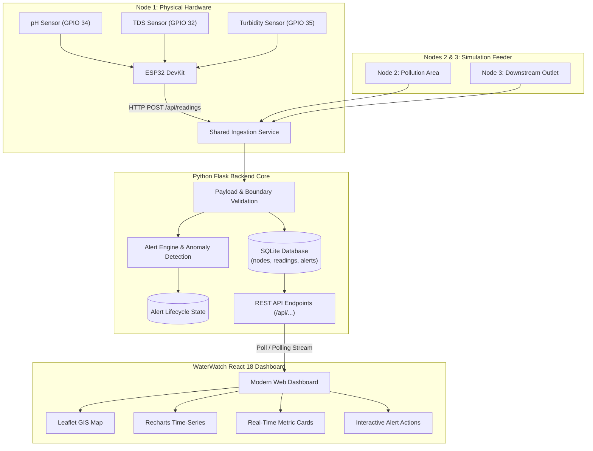

# WaterWatch — Real-Time Water Quality Sensor Network (Hybrid)

[](https://www.python.org/)
[](https://flask.palletsprojects.com/)
[](https://react.dev/)
[](https://vitejs.dev/)
[](https://opensource.org/licenses/MIT)

**WaterWatch** is a full-stack environmental IoT water-quality monitoring system. It receives telemetry from physical ESP32 sensor hardware and software-simulated stations, evaluates screening thresholds, detects statistical anomalies, and displays live updates on a modern dashboard.

---

## System Architecture



---

## Hardware Pin Mapping (Node 1 — ESP32 DevKit)

| Sensor Module | Module Pin | ESP32 GPIO | ADC Channel | Operating Limits |
| :--- | :--- | :--- | :--- | :--- |
| **Analog pH Sensor** | PO (Analog Output) | **GPIO 34** | ADC1_CH6 | 0.0 – 14.0 pH |
| **Analog TDS Sensor** | AO (Analog Output) | **GPIO 32** | ADC1_CH4 | 0 – 1000+ ppm |
| **Analog Turbidity** | AO (Analog Output) | **GPIO 35** | ADC1_CH7 | 0 – 100+ NTU (requires &le;3.3V divider) |
| *Common Grounds* | GND | **GND** | — | Tied to common ground |

> **Note on ADC Selection:** Only **ADC1** pins are utilized because ADC2 is disabled on ESP32 while Wi-Fi is transmitting.

---

## Configured Screening Thresholds

| Water Quality Parameter | Normal Standard | Warning Range | Critical Alert | Standard Source |
| :--- | :--- | :--- | :--- | :--- |
| **pH Level** | **6.50 – 8.50 pH** | 6.00–6.50 / 8.50–9.00 | **&lt; 6.00 or &gt; 9.00** | WHO Drinking-Water Guidelines |
| **Turbidity** | **&le; 5.0 NTU** | 5.0 – 10.0 NTU | **&gt; 10.0 NTU** | Filtration & Aesthetic Baseline |
| **Total Dissolved Solids** | **&le; 500 ppm** | 500 – 1000 ppm | **&gt; 1000 ppm** | Palatability Screening Limit |
| **Temperature** | **&le; 30.0 °C** | 30.0 – 35.0 °C | **&gt; 35.0 °C** | Thermal Discharge Baseline |

---

## Quickstart Guide

### 1. Start the Flask Backend (Terminal 1)
```powershell
cd "d:\AntiGravity demo"
python -m pip install -r backend/requirements.txt
python -m pytest tests/
python -m backend.app
```
*Backend runs on `http://localhost:5000`.*

### 2. Start the React Frontend (Terminal 2)
```powershell
cd "d:\AntiGravity demo"
npm run dev
```
*Open `http://localhost:5173` in your browser.*

---

## Project Structure

```text
├── backend/
│   ├── app.py                      # Flask factory & development server
│   ├── config.py                   # Environment configuration & SQLite settings
│   ├── database.py                 # SQLAlchemy initialization
│   ├── models.py                   # Node, Reading, and Alert database entities
│   ├── routes/
│   │   └── api.py                  # Full REST API endpoints (/api/readings, /api/nodes, /api/alerts)
│   ├── services/
│   │   ├── ingestion.py            # Shared ingestion pipeline & data validation
│   │   ├── threshold_engine.py     # Threshold rules & alert deduplication
│   │   ├── anomaly_engine.py       # MAD Z-score statistical & multivariate anomaly detection
│   │   ├── simulator.py            # Background feeder for simulated Nodes 2 & 3
│   │   └── mqtt_service.py         # Optional Paho MQTT bridge
│   ├── seed.py                     # Idempotent database seeder
│   └── requirements.txt            # Python dependencies
├── firmware/
│   └── esp32_waterwatch/
│       ├── esp32_waterwatch.ino    # Arduino C++ sketch for ESP32 DevKit
│       ├── config.h                # Local configuration (Wi-Fi credentials & LAN IP)
│       └── config.h.example        # Configuration template
├── src/
│   ├── components/                 # Reusable UI components
│   │   ├── KPICards.jsx            # Sensor cards with threshold ranges & units
│   │   ├── NetworkMap.jsx          # Leaflet GIS map with node markers
│   │   ├── HistoricalCharts.jsx    # Time-series charts with threshold reference lines
│   │   ├── RealTimeAndAlertsPanel.jsx # Real-time stream & live alert actions
│   │   ├── DataTablePanel.jsx      # Node network status & persisted readings table
│   │   └── Layout.jsx              # Forest green sidebar & topbar navigation
│   ├── pages/                      # Working pages for all 7 navigation items
│   │   ├── DashboardPage.jsx       # Main environmental monitoring dashboard
│   │   ├── MapPage.jsx             # Fullscreen catchment network GIS map
│   │   ├── NodesPage.jsx           # Hardware architecture & pinout inspector
│   │   ├── AnalyticsPage.jsx       # Multi-parameter correlations & distributions
│   │   ├── AlertsPage.jsx          # Full incident lifecycle & resolution panel
│   │   ├── HistoryPage.jsx         # Historical database records & CSV export
│   │   └── SettingsPage.jsx        # Demo controls, data mode switcher & guide
│   ├── context/
│   │   └── MonitoringContext.jsx   # Global state & backend synchronization
│   ├── services/
│   │   ├── apiClient.js            # REST API client
│   │   ├── apiSource.js            # Live telemetry polling adapter
│   │   ├── simulatorSource.js      # In-browser standalone fallback simulator
│   │   └── mqttSource.js           # Optional MQTT WebSocket adapter
│   └── index.css                   # Forest green, teal & botanical light surfaces design
├── tests/
│   ├── conftest.py                 # Pytest fixtures & isolated in-memory DB
│   └── test_api.py                 # 10 comprehensive backend test cases
└── docs/
    ├── HARDWARE_WIRING_AND_CALIBRATION.md # Detailed hardware wiring & calibration guide
    ├── API_DOCUMENTATION.md        # REST API contracts & JSON payload specifications
    ├── SETUP_POWERSHELL.md         # Windows PowerShell setup instructions
    └── DEMO_AND_TROUBLESHOOTING.md # Demo scenarios, MQTT broker setup & troubleshooting
```

---

## Detailed Documentation
- [Hardware Wiring & Sensor Calibration Guide](file:///d:/AntiGravity%20demo/docs/HARDWARE_WIRING_AND_CALIBRATION.md)
- [REST API Documentation & JSON Payloads](file:///d:/AntiGravity%20demo/docs/API_DOCUMENTATION.md)
- [Windows PowerShell Setup Instructions](file:///d:/AntiGravity%20demo/docs/SETUP_POWERSHELL.md)
- [Demonstration Scenarios & Troubleshooting](file:///d:/AntiGravity%20demo/docs/DEMO_AND_TROUBLESHOOTING.md)
